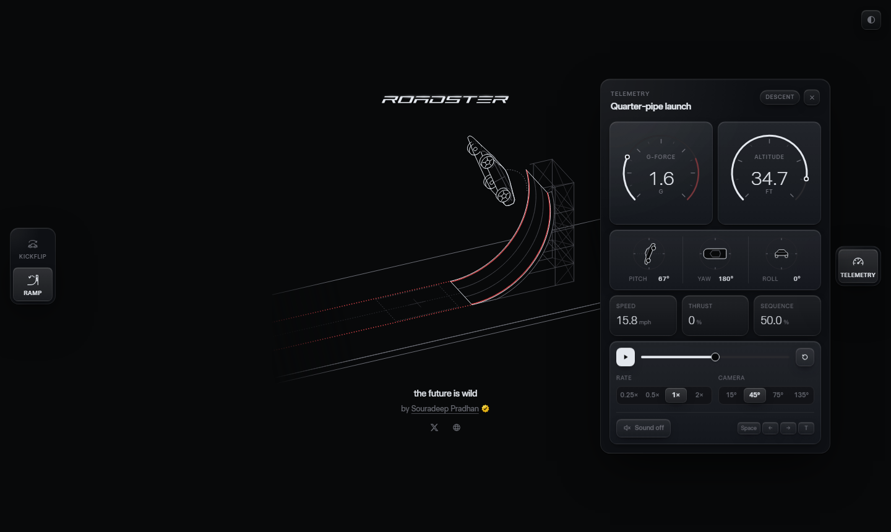
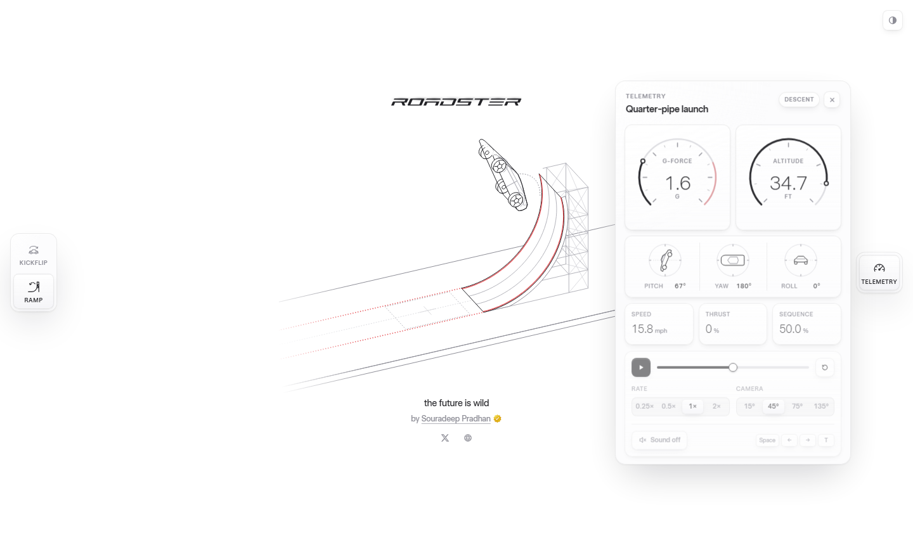

# Roadster

**The future is wild.** An interactive line-art study of the Tesla Roadster doing what cars shouldn't: a kickflip over the fleet and a launch off a C-shaped ramp on cold-gas thrusters, with live telemetry from every frame.

**[Live demo → pradhan-not-found.github.io/Roadster](https://pradhan-not-found.github.io/Roadster/)**

Built from scratch with React, TypeScript and hand-written SVG. No 3D engine, no canvas, no animation library.

<p align="center">
  
</p>

## Sequences

**Kickflip.** The Roadster fires its thrusters, clears a row of Model 3, Semi, Model Y and Cybertruck, rolls a full 360° and lands on the far side.

**Ramp.** The Roadster drives into a C-shaped ramp hung from a steel gantry. The track curves up, runs vertical, then curls over the top, so the car rides the overhang upside down and leaves the lip inverted. Its thrusters push it clear, it half-rolls upright, then comes down on four cold-gas jets into a ring of smoke and drives away.

Both sequences use real gravity in scene units (the Roadster is 13.1 ft long), so the numbers on the instruments aren't made up.

## Telemetry

Open the panel from the right-hand rail. It reads the motion live:

| Instrument | What it shows |
| --- | --- |
| **G-force** | What you'd feel in the cabin: gravity plus acceleration. Peaks around 8 G at the foot of the ramp, near 0 G in free fall |
| **Altitude** | Height of the car above the deck in feet. Peaks around 29 ft on the ramp |
| **Pitch / Yaw / Roll** | Attitude dials with side, top and rear outlines of the car |
| **Speed / Thrust / Sequence** | Speed in mph, how hard the jets are firing, and progress through the loop |

You can also scrub the timeline, change the playback rate (0.25× to 2×), move the camera (15°, 45°, 75°, 135°) and turn sound on or off.

<p align="center">
  
</p>

## Controls

| Key | Action |
| --- | --- |
| <kbd>Space</kbd> | Play / pause |
| <kbd>←</kbd> <kbd>→</kbd> | Step back / forward |
| <kbd>T</kbd> | Toggle light / dark |

## Run it locally

Requires Node 20 or later.

```bash
git clone https://github.com/pradhan-not-found/Roadster.git
cd Roadster
npm install
npm run dev
```

| Script | Purpose |
| --- | --- |
| `npm run dev` | Start the dev server |
| `npm run build` | Type-check and build for production into `dist/` |
| `npm run preview` | Serve the production build |
| `npm run lint` | Lint with Oxlint |

## How it works

Every vehicle is a side profile extruded across its width. Each frame, the faces are projected through a small isometric camera, culled by facing and sorted by depth, then written straight into SVG paths. React owns the UI; the scenes update the DOM directly at 60 fps.

```
src/
├── engine/
│   ├── math.ts        projection, rotation frames, kickflip trajectory
│   ├── ramp.ts        C-ramp geometry and launch physics
│   ├── renderer.ts    face culling, depth sort, SVG output
│   └── telemetry.ts   G-force, altitude and speed from the motion
├── components/
│   ├── KickflipCanvas.tsx
│   ├── RampCanvas.tsx
│   ├── TelemetryPanel.tsx
│   └── Instruments.tsx   dials and attitude indicators
├── data/vehicles.ts   Roadster, Model 3, Model Y, Cybertruck, Semi
└── audio/sounds.ts    thruster and landing sounds (Web Audio)
```

## Deploy

Every push to `main` builds and publishes to GitHub Pages through [`.github/workflows/deploy.yml`](.github/workflows/deploy.yml). The site is served from `/Roadster/`, set as `base` in [`vite.config.ts`](vite.config.ts). If you fork the repo under another name, change both `base` and the URLs in `index.html`.

## Author

**Souradeep Pradhan** · [souradeep.me](https://souradeep.me/) · [@bysoura](https://x.com/bysoura)

## License

Code is released under the [MIT License](LICENSE).

This is an independent fan project. It is not affiliated with, endorsed by or sponsored by Tesla, Inc. or SpaceX. "Tesla", "Roadster", "Model 3", "Model Y", "Cybertruck" and "Semi" are trademarks of their respective owners. The typeface in `public/font` is licensed separately by its owner.
